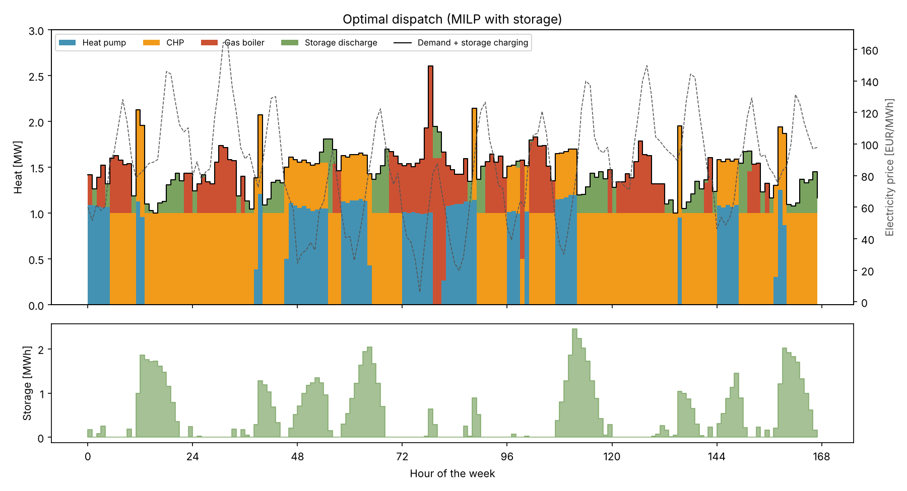
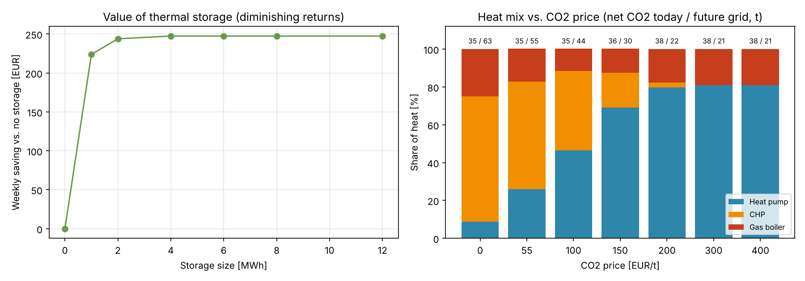

# Heating Network Dispatch – Mixed-Integer Unit Commitment with Thermal Storage

How should a small district heating network run its heat pump, combined heat and power (CHP) engine,
gas boiler and storage tank, hour by hour, when electricity prices change every hour?

This project solves that question as a **mixed-integer linear program (MILP)** in Python for one winter week
and compares it with a simple hour-by-hour controller. Optimal scheduling cuts the weekly operating cost by
**24%** and net CO2 emissions by **25%**. A CO2 price sensitivity analysis then shows when heat pumps take over,
and why that only reduces emissions once the power grid gets cleaner.



## Plant

| Unit | Size | Key properties |
|---|---|---|
| Air-source heat pump | 0.45 MW electric | COP 2.2–2.8 from a Carnot model of the outdoor temperature; pays spot price + 60 EUR/MWh grid fees; min. load 25% |
| CHP gas engine | 1.0 MW heat | 45% thermal efficiency, sells 0.85 MW electricity per MW heat at the spot price; min. load 50%; 120 EUR start-up cost; must run ≥ 4 h once started |
| Gas boiler | 1.6 MW heat | 92% efficiency; min. load 20% |
| Thermal storage | 4 MWh | max. 1 MW charge/discharge; 0.5% heat loss per hour; starts and ends empty |

**Inputs (synthetic, one winter week, hourly):** outdoor temperature between −8 °C and +6 °C with a mid-week cold front,
heat demand of 0.9–2.0 MW with morning and evening peaks, and day-ahead electricity prices of 6–165 EUR/MWh
with solar dips at noon and evening peaks. Gas costs 40 EUR/MWh plus a CO2 price of 55 EUR/t.

## Mathematical model

For every hour `t`: heat pump electricity `p_hp[t]`, CHP heat `q_chp[t]`, boiler heat `q_b[t]`, storage charge `ch[t]`,
discharge `dis[t]` and level `soc[t]`, binary on/off variables `u[t]` per unit, and a CHP start-up variable `v[t]`.

```
min  Σ_t  (spot[t] + fee) · p_hp[t]                             buy electricity for the heat pump
        + c_gas · ( q_chp[t] / η_chp + q_b[t] / η_b )           buy gas, including the CO2 price
        − spot[t] · r · q_chp[t]                                 sell CHP electricity
        + c_start · v[t]                                         CHP start-up cost

s.t.  COP[t]·p_hp[t] + q_chp[t] + q_b[t] + dis[t] − ch[t] = demand[t]       heat balance
      soc[t] = (1 − loss)·soc[t−1] + ch[t] − dis[t],   soc[t] ≤ cap            storage dynamics
      min_load · max · u[t] ≤ output[t] ≤ max · u[t]                         on/off with minimum load
      v[t] ≥ u_chp[t] − u_chp[t−1]                                           start-up detection
      Σ_{τ=t−3..t} v[τ] ≤ u_chp[t]                                           minimum up time (4 h)
      soc[end] ≥ soc[start]                                                 no free heat from the tank
```

The week has 168 hours, so the model has about 1,700 variables (504 binary). HiGHS solves it to optimality
(0.01% gap) in under a second, via `scipy.optimize.milp`.

## Experiments

1. **Optimal vs. rule of thumb:** the full-week MILP vs. the same MILP without storage vs. an **hour-by-hour controller** that picks the cheapest units each hour without looking ahead (what a simple control system does).
2. **Value of storage:** re-optimise with tank sizes from 0 to 12 MWh.
3. **CO2 price sensitivity:** re-optimise for CO2 prices from 0 to 400 EUR/t. Net CO2 counts gas burned plus grid electricity bought, minus grid electricity displaced by the CHP (the standard credit method), with today's grid mix (0.38 t/MWh) and a future, cleaner grid (0.15 t/MWh).

## Results

| One winter week | Optimal (MILP) | Optimal, no storage | Hour-by-hour controller |
|---|---|---|---|
| Operating cost | **9,364 EUR** | 9,611 EUR | 12,361 EUR |
| Cost per MWh of heat | **40.4 EUR** | 41.5 EUR | 53.4 EUR |
| Net CO2 (today's grid) | **34.5 t** | 36.6 t | 46.0 t |
| Heat from heat pump / CHP / boiler | 26% / 57% / 17% | 23% / 49% / 28% | 31% / 0% / 69% |
| CHP starts | 2 | 3 | 0 |



### Key insights

1. **Look-ahead is worth far more than hardware.** The hour-by-hour controller never starts the CHP: a 120 EUR
   start-up never pays off within a single hour. The MILP sees that a multi-hour run during expensive-electricity
   hours does, and saves **24%** of the weekly cost (about 3,000 EUR) and **25%** of net CO2.
2. **A small tank captures all of the storage value.** Storage saves 2.6% (247 EUR/week) on top of optimal scheduling,
   and the saving stops growing at 4 MWh. The tank lets the CHP run at full load through price peaks and covers
   short gaps, which saves one CHP start and cuts boiler use from 28% to 17% of the heat.
3. **The heat pump follows the electricity price.** It runs at night and during the solar dip at noon, when power
   is cheap, and switches off during the evening peaks, when the CHP earns the most by selling electricity.
4. **A CO2 price on heat alone does not cut emissions with today's grid.** Raising the CO2 price from 55 to
   200 EUR/t lifts the heat pump's share from 26% to 80%, but net CO2 *rises* by 10% (34.5 t to 38.1 t). The heat pump
   replaces CHP heat that came with credited, grid-displacing electricity. With a cleaner future grid, the same
   shift **cuts emissions by 60%** (54.5 t to 22.1 t). The policy and the grid have to move together.

## How to run

```bash
pip install -r requirements.txt
python src/run.py
```

All tables and figures are written to `results/`. The full run takes about 10 seconds.

## Project structure

```
src/data.py    plant parameters and the synthetic winter week (temperature, demand, prices, COP)
src/milp.py    small MILP builder around SciPy's HiGHS interface
src/model.py   unit commitment and dispatch MILP, hour-by-hour controller, cost and CO2 evaluation
src/run.py     experiments and plots
results/       CSV outputs and figures
```

## Limitations and possible extensions

- **Perfect foresight:** the MILP knows the whole week's prices and demand in advance. A **rolling-horizon** model
  that re-plans every few hours with forecasts would be more realistic, and the gap between the two is the value of
  better forecasting.
- **Network physics:** supply temperatures, pipe losses and flow limits are not modelled; adding them makes the model
  nonlinear (MINLP).
- **Stochastic prices:** a two-stage stochastic version over price scenarios, as in my
  [medicine supply project](https://github.com/neethu-cyber/resilient-medicine-supply-optimization).
- **Real data:** ENTSO-E day-ahead prices and DWD weather data.
